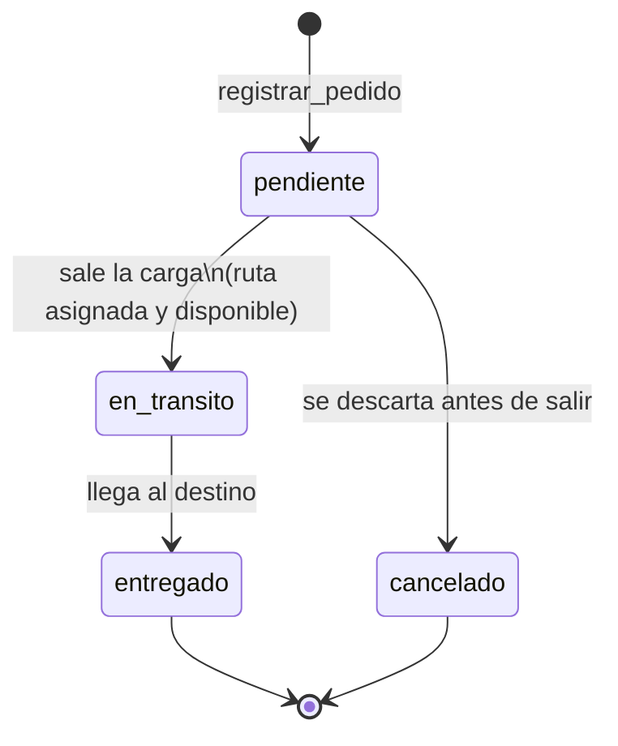

# Acta del Documentador — Rutas del Bajío

Act03_P2 · Etapa 2 (equipo). Define el **ciclo de vida del pedido**, las **reglas de limpieza y rechazo de la carga por lote**, la **matriz de criterios de prueba** y la **carga de trabajo**. Es el plano del trabajo siguiente; todavía no se programa.

| | |
|---|---|
| **Equipo** | Eugenio Team (Prof. Eugenio Salvador Martínez Velázquez) |
| **Fecha** | 15 de octubre de 2026 |
| **Documentador** | Edgar Alexis Sánchez Huerta |
| **Arquitecto** | Edgar Daniel Zuñiga Gonzalez *(confirmar rol de la rotación)* |
| **Desarrollador CRUD** | Cristian Ibrahim Salomon Marquez *(confirmar rol de la rotación)* |
| **Encargado de Pruebas** | Luis Mario Juarez Rolón *(confirmar rol de la rotación)* |

---

## Sección A. Alcance

| Elemento | Qué se cubre | Fuera de alcance / observación |
|---|---|---|
| Pedido (estados) | Los 4 estados que ya existen en el código (`ESTADOS` en `modelos.py`): `pendiente`, `en_transito`, `entregado`, `cancelado`. Transiciones de `GestorRutasBajio.cambiar_estado` y `cancelar_pedido`; el estado nuevo persiste en `pedidos.csv` | Estados nuevos (p. ej. "devuelto", "retrasado"); fechas de cada cambio (historial); cambiar el estado de varios pedidos a la vez |
| Archivo de lote (columnas) | Un CSV de **pedidos nuevos** con las mismas 9 columnas del Pedido del Sprint 2, en este orden: `folio, id_cliente, producto, cantidad, origen, destino, fecha, estado, id_ruta`. Codificación UTF-8, encabezado en la línea 1 | Lotes de clientes o de rutas; lotes que actualicen pedidos ya existentes (todo pedido del lote es nuevo); Excel u otros formatos |
| Persistencia (CSV principal y de rechazos) | Las filas aceptadas se agregan a `pedidos.csv` con el mismo mecanismo atómico de `_escribir`, y `secuencias.csv` avanza. Las rechazadas se escriben en `rechazos_pedidos.csv` (mismo directorio de datos) | Reintento automático de filas rechazadas; enviar el reporte por correo; deshacer un lote ya cargado |

Estado actual del código que se toma como punto de partida: el `Pedido` nace en `pendiente`; `crear_pedido` rechaza cualquier otro estado inicial; `Pedido.__init__` exige ruta en `en_transito` y `entregado`; la tabla de transiciones está en un diccionario dentro de `cambiar_estado`.

---

## Tabla 1. Estados y transiciones del pedido

Estado inicial: **pendiente**. Estados finales: **entregado**, **cancelado**.

| Estado actual | Puede pasar a | Evento o regla de negocio | Justificación / transición prohibida más importante |
|---|---|---|---|
| `pendiente` | `en_transito`, `cancelado` | Pasa a `en_transito` cuando sale la carga: exige **ruta asignada, disponible y del mismo trayecto** del pedido. Pasa a `cancelado` si el cliente o la empresa lo descartan antes de salir | **Prohibido** `pendiente → entregado`: no se puede entregar lo que nunca salió, y se saltaría la verificación de ruta |
| `en_transito` | `entregado` | La mercancía llega al destino | **Prohibido** `en_transito → cancelado`: la carga ya salió; cancelar dejaría un camión en camino sin pedido que lo respalde. **Prohibido** `en_transito → pendiente`: se perdería el rastro de que la carga salió |
| `entregado` | *(ninguno)* | Estado final | **Prohibido** reabrirlo o regresarlo (`→ pendiente`, `→ en_transito`): un pedido entregado ya se facturó; si hay un problema se registra un pedido nuevo |
| `cancelado` | *(ninguno)* | Estado final | **Prohibido** resucitarlo (`→ pendiente`): se registra un pedido nuevo con otro folio. Un folio nunca vuelve a usarse |

Transiciones prohibidas adicionales que también se prueban: cualquier destino igual al estado actual (`pendiente → pendiente`) y cualquier estado que no esté en el catálogo (`"perdido"`).

### Diagrama de estados



```
          registrar_pedido
                 |
                 v
          +------------+  sale la carga (con ruta)  +-------------+  llega  +-----------+
          | pendiente  | -------------------------> | en_transito | ------> | entregado | (final)
          +------------+                            +-------------+         +-----------+
                 |
                 | se descarta antes de salir
                 v
          +------------+
          | cancelado  | (final)
          +------------+
```

**Respuestas del equipo a las preguntas detonadoras (Paso 2)**

| Pregunta | Decisión |
|---|---|
| ¿Qué pasa con el pedido cuando una transición se rechaza? | Se lanza `ValueError("Cambio no permitido: X -> Y.")`; el estado **no cambia** y `pedidos.csv` queda idéntico. |
| ¿Se puede cancelar? | Sí, solo desde `pendiente`. |
| ¿Se puede reabrir un pedido terminado? | No, ni `entregado` ni `cancelado`. |
| ¿Dónde viven las reglas? | En una tabla de datos (diccionario de transiciones), no en `if` encadenados. Hoy el diccionario está dentro del método; se propone subirlo a una constante `TRANSICIONES` en `modelos.py` para poder probar la tabla por sí sola (ver Tabla 5). |

---

## Tabla 2. Reglas de limpieza y rechazo del lote

**Principio:** *limpiar* es arreglar sin cambiar el significado; *rechazar* es descartar una fila que no se puede aprovechar y **el lote continúa**; solo los problemas **del archivo** (no de una fila) detienen todo el lote.

| Campo | Limpieza (se arregla) | Se rechaza si... | Motivo escrito en el reporte | ¿Detiene el lote? |
|---|---|---|---|---|
| `folio` | Quita espacios y pasa a mayúsculas (`" ped-0005 "` → `PED-0005`) | Queda vacío, no cumple `PED-NNNN`, **ya existe** en el gestor o **se repite** antes en el mismo archivo | `folio vacío` · `folio inválido: 'PED-5' (se espera PED-0000)` · `folio duplicado: PED-0001` | No: solo la fila |
| `id_cliente` | Quita espacios y pasa a mayúsculas (`"cli-010"` → `CLI-010`) | Queda vacío, no cumple `CLI-NNN` o **no existe** en clientes (llave foránea) | `cliente inválido: 'CLI-1'` · `cliente no existe: CLI-099` | No: solo la fila |
| `producto` | Quita espacios en los extremos y compacta espacios repetidos (`"  Acero   en  rollo "` → `Acero en rollo`) | Queda vacío | `producto vacío` | No: solo la fila |
| `cantidad` | Quita espacios (`" 40 "` → `40`) | No es entero (`"muchas"`, `"3.5"`), es cero o negativo | `cantidad inválida: 'muchas' (se espera un entero mayor que cero)` · `cantidad inválida: '-5'` | No: solo la fila |
| `origen`, `destino` | Quita espacios y normaliza mayúsculas al catálogo (`" león "` → `León`) | Ciudad fuera del catálogo, o origen = destino | `ciudad inválida: 'Morelia' (opciones: León, Irapuato, ...)` · `origen y destino iguales: León` | No: solo la fila |
| `fecha` | Quita espacios | No es `AAAA-MM-DD` o no existe en el calendario | `fecha inválida: '15/09/2026' (se espera AAAA-MM-DD)` · `fecha inválida: '2026-02-30' (no existe)` | No: solo la fila |
| `estado` | Quita espacios y pasa a minúsculas; **vacío = `pendiente`** | Es distinto de `pendiente` (un pedido nuevo solo nace pendiente); incluye estados que no existen | `estado inicial inválido: 'entregado' (un pedido nuevo debe ser pendiente)` | No: solo la fila |
| `id_ruta` | Quita espacios y pasa a mayúsculas; vacío = sin ruta (válido) | Viene con valor y: no cumple `RUTA-NN`, **no existe**, no hace el mismo trayecto que el pedido, o **no está disponible** | `ruta no existe: RUTA-99` · `la ruta RUTA-03 no coincide con el trayecto León -> Irapuato` · `ruta no disponible: RUTA-02` | No: solo la fila |
| Fila completa | Ignora líneas totalmente vacías | Tiene menos o más columnas que el encabezado | `fila incompleta: se esperaban 9 columnas y llegaron 7` | No: solo la fila |
| Encabezado | Quita espacios y compara sin distinguir mayúsculas | Faltan columnas requeridas, sobran columnas o hay nombres distintos | `encabezado incorrecto: faltan [cantidad]; sobran [piezas]` | **Sí: el archivo completo** (no se carga ni una fila) |
| Archivo | — | Está vacío (sin ni siquiera encabezado), no se puede leer como UTF-8 o no existe | `archivo vacío` · `archivo no es UTF-8` · `archivo no encontrado` | **Sí: el archivo completo** |

**Reglas generales de la carga**

- Una fila con **varios** errores se rechaza una sola vez, con el **primer** error encontrado, en el orden de las columnas. *Alternativa descartada:* listar todos los errores de la fila; es más cómodo para quien corrige pero complica el reporte y la prueba. Se deja para después.
- Un lote **sin ningún error de archivo** nunca lanza excepción por filas malas: devuelve cuántas se aceptaron y cuántas se rechazaron.
- Un lote que solo trae encabezado es válido: 0 aceptadas, 0 rechazadas.
- Cargar dos veces el mismo archivo no duplica nada: la segunda vez todas las filas se rechazan por `folio duplicado`.

**Reporte de rechazos (`rechazos_pedidos.csv`)**

| Columna | Contenido |
|---|---|
| `linea` | Número de línea del archivo original (el encabezado es la línea 1; la primera fila de datos, la 2). Así se encuentra la fila con un editor de texto |
| `folio` | El folio tal como llegó (puede ir vacío) |
| `campo` | Columna que causó el rechazo (`cantidad`, `id_cliente`, `fila`, ...) |
| `motivo` | Texto de la tabla anterior, con el valor recibido entre comillas, redactado para que quien corrige no tenga que adivinar |
| `valor_recibido` | Contenido original de esa celda, sin limpiar |

El reporte se **sobrescribe** en cada carga y solo se crea si hubo al menos un rechazo. Debe soportar comas y acentos en `motivo` (se escribe con `csv.DictWriter`).

---

## Tabla 3. Matriz de criterios de prueba

Tipos: transición válida · transición inválida · estado final · limpieza · rechazo · lote · persistencia · relación. Prioridad: A (alta), M (media), B (baja), justificada por el daño al proceso. Componentes nuevos propuestos: `limpiar_fila` y `cargar_lote` (módulo `rutas_bajio/lotes.py`), `TRANSICIONES` y las excepciones `FilaInvalidaError` y `LoteInvalidoError`.

| ID | Componente | Criterio (qué se verifica) | Tipo | Escenario y datos | Resultado esperado | Prior. | Cómo se verificará |
|---|---|---|---|---|---|---|---|
| C-01 | `cambiar_estado` | Cada transición permitida cambia el estado | Transición válida | `pendiente → en_transito` (con `RUTA-03` disponible), `en_transito → entregado`, `pendiente → cancelado` | Devuelve `True` y `estado` es el destino | A — es el flujo normal del negocio | `parametrize` + `assert` |
| C-02 | `cambiar_estado` | Una transición prohibida lanza error y deja el estado intacto | Transición inválida | `pendiente → entregado`, `en_transito → cancelado`, `en_transito → pendiente`, `pendiente → pendiente` | `ValueError` ("Cambio no permitido"); el estado en memoria y en `pedidos.csv` no cambió | A — cancelar o saltarse pasos deja cargas sin control | `parametrize` + `pytest.raises` + `assert` |
| C-03 | `TRANSICIONES` / `cambiar_estado` | Los estados finales no tienen salidas | Estado final | `entregado` y `cancelado` hacia cada uno de los 4 estados | Tabla sin destinos para ambos; todo intento lanza `ValueError` | A — reabrir un entregado ya facturado | `assert` sobre la tabla + `parametrize` + `pytest.raises` |
| C-04 | `cambiar_estado` | No sale a tránsito un pedido sin ruta | Transición inválida | `PED` pendiente con `id_ruta=None` → `en_transito` | `ValueError` ("requiere una ruta"); sigue `pendiente` | A — carga sin transportista que la rastree | `pytest.raises` + `assert` |
| C-05 | `cambiar_estado` | Estado inexistente o folio inexistente | Transición inválida | Estado `"perdido"`; folio `PED-9999` | `"perdido"` → `ValueError`, estado intacto; `PED-9999` → `False` | M — error de captura, no daña datos | `pytest.raises` + `assert` |
| C-06 | `limpiar_fila` | Normaliza una fila sucia sin cambiar su significado | Limpieza | Fila con `" ped-0005 "`, `"cli-010"`, `"  Acero   en  rollo "`, `" 40 "`, `" león "`, `estado=""`, `id_ruta=" ruta-01 "` | Devuelve `PED-0005`, `CLI-010`, `Acero en rollo`, `40`, `León`, `estado == "pendiente"`, `RUTA-01` | A — sin esta limpieza se rechazarían filas buenas | `assert` sobre el diccionario devuelto |
| C-07 | `limpiar_fila` | Cada regla de rechazo informa campo y motivo | Rechazo | `cantidad` = `"0"`, `"-5"`, `"muchas"`, `"3.5"`; `origen` = `"Morelia"`; origen = destino; `fecha` = `"2026-02-30"`, `"15/09/2026"`; `producto=""`; `folio="PED-5"` | `FilaInvalidaError` cuyo mensaje contiene el campo y el valor recibido | A — un dato malo en `pedidos.csv` distorsiona la carga y la facturación | `parametrize` + `pytest.raises(match=...)` |
| C-08 | `limpiar_fila` | El estado inicial solo puede ser `pendiente` | Rechazo | `estado` = `"entregado"`, `"cancelado"`, `"perdido"`; vacío; `" Pendiente "` | Los tres primeros → `FilaInvalidaError`; vacío y `" Pendiente "` → `"pendiente"` | A — un pedido nuevo ya "entregado" salta toda la verificación | `parametrize` + `pytest.raises` / `assert` |
| C-09 | `cargar_lote` | Cliente inexistente rechaza la fila | Relación | Fila con `CLI-099` en un gestor que solo tiene `CLI-010` y `CLI-011` | Fila rechazada con motivo "cliente no existe: CLI-099"; `pedidos` no crece | A — pedido huérfano | `assert` sobre el reporte y `gestor.pedidos` |
| C-10 | `cargar_lote` | La ruta debe existir, hacer el mismo trayecto y estar disponible | Relación | `RUTA-99` (no existe); `RUTA-01` en un pedido León→Celaya; `RUTA-02` (no disponible) | Tres filas rechazadas, cada una con su motivo; ninguna se guarda | A — carga enviada a un destino equivocado o con camión ocupado | `parametrize` + `assert` sobre el reporte |
| C-11 | `cargar_lote` | Un folio repetido se rechaza (ya existe o se repite en el archivo) | Rechazo | `PED-0001` (ya registrado) y un archivo con `PED-0005` dos veces | `PED-0001` rechazado; de `PED-0005` solo se acepta la primera, la segunda se rechaza "folio duplicado" | A — dos pedidos con el mismo folio | `assert` |
| C-12 | `cargar_lote` | Una fila mala no detiene el lote | Lote | Lote de 5 filas: 2 buenas, 3 malas (cantidad, ciudad, cliente) | `aceptadas == 2`, `rechazadas == 3`; `pedidos.csv` tiene las 2 buenas más las existentes; las 3 líneas aparecen en el reporte | A — es el objetivo del lote: no perder filas buenas por una mala | `assert` |
| C-13 | `cargar_lote` | Un encabezado equivocado detiene todo el lote | Lote | Archivo sin la columna `cantidad`; archivo con columna extra `piezas`; encabezado vacío | `LoteInvalidoError` ("encabezado incorrecto..."); `pedidos.csv` idéntico antes y después; no se crea `rechazos_pedidos.csv` | A — cargar datos corridos de columna en silencio | `pytest.raises` + `assert` sobre archivos |
| C-14 | `cargar_lote` | Archivo vacío o solo con encabezado | Lote | Archivo de 0 bytes; archivo con una línea de encabezado | 0 bytes → `LoteInvalidoError` ("archivo vacío"); solo encabezado → `aceptadas == 0`, `rechazadas == 0`, sin excepción | M — caso límite poco frecuente, no daña datos | `pytest.raises` + `assert` |
| C-15 | `cargar_lote` (reporte) | El reporte indica línea y motivo exactos | Rechazo | Rechazo en la 3.ª fila de datos con valor `"Acero, Fundición"` y acentos | En `rechazos_pedidos.csv`: `linea == 4` (el encabezado es la 1), `campo`, `motivo` y `valor_recibido` correctos; comas y acentos intactos al releerlo | M — sin línea y motivo, quien corrige tiene que adivinar | `assert` leyendo el CSV con `csv.DictReader` |
| C-16 | `cargar_lote` + `cargar` | Lo aceptado persiste y el folio avanza | Persistencia | Lote con `PED-0005` y `PED-0007`; recargar con otro gestor sobre el mismo directorio | Ambos pedidos vuelven iguales; `ultimo_folio == 7`; el siguiente `registrar_pedido` da `PED-0008` | A — dato perdido o folio repetido | Prueba de integración + `assert` |
| C-17 | `cambiar_estado` + `cargar` | El cambio de estado persiste | Persistencia | `pendiente → en_transito → entregado`, recargando en cada paso | El estado nuevo se conserva al recargar | A | Prueba de integración + `assert` |
| C-18 | `cargar_lote` | Cargar el mismo archivo dos veces no duplica | Lote | Mismo archivo con 3 filas buenas, cargado dos veces | 1.ª carga: 3 aceptadas; 2.ª carga: 0 aceptadas, 3 rechazadas por "folio duplicado"; `pedidos` sigue con 3 filas nuevas | A — reintento de un lote por error | `assert` |
| C-19 | `cargar_lote` | Una fila con columnas de menos o de más se rechaza sin romper el lote | Rechazo | Fila con 7 columnas en medio de filas buenas | Rechazada con "fila incompleta: se esperaban 9 columnas y llegaron 7"; las demás se procesan | M | `assert` |

**Cobertura de mínimos:** 19 criterios (mín. 8) · transición válida: 1 · transición inválida: 3 · estado final: 1 · limpieza: 1 · rechazo: 4 · relación: 2 · lote: 4 · persistencia: 2 · prioridad A: 15.

---

## Tabla 4. Carga de trabajo

Cada integrante implementa un bloque. Orden justificado por la prioridad: primero lo que protege los datos y el flujo del pedido (todo A), después la limpieza y el lote, y al final lo que depende de los anteriores.

| Integrante | Rol | Bloque de criterios (IDs) | Archivo de pruebas | Orden |
|---|---|---|---|---|
| Edgar Daniel Zuñiga Gonzalez | Arquitecto | C-01, C-02, C-03, C-04, C-05 (estados) | `tests/test_transiciones.py` | 1.º — todos A salvo C-05; es la base del resto |
| Cristian Ibrahim Salomon Marquez | Desarrollador CRUD | C-06, C-07, C-08, C-19 (limpieza y rechazo de fila) | `tests/test_limpieza.py` | 2.º — `limpiar_fila` es la pieza que usa el lote |
| Luis Mario Juarez Rolón | Encargado de Pruebas | C-09, C-10, C-11, C-12 (relaciones y lote mixto) | `tests/test_lote.py` | 3.º — necesita `limpiar_fila` ya probada |
| Edgar Alexis Sánchez Huerta | Documentador | C-13, C-14, C-15, C-18 (archivo y reporte) y C-16, C-17 (persistencia); revisión del acta | `tests/test_lote_archivo.py` y `tests/test_persistencia.py` | 4.º — dependen de los bloques anteriores; 2 de sus 6 criterios son A de persistencia |

Reparto: 5, 4, 4 y 6 criterios; el Documentador toma más porque C-14, C-15 y C-17 son cortos. Dentro de cada archivo se escribe primero lo de prioridad A.

---

## Tabla 5. Decisiones de estructura de la suite

| Decisión | Alternativas consideradas | Decisión tomada | Justificación | Responsable |
|---|---|---|---|---|
| **Archivos de prueba y nombres** | a) Agregar todo a `test_estados.py` y `test_integracion.py` (del Acta anterior); b) un archivo por tema nuevo; c) un solo `test_lote.py` | **(b)**: `test_transiciones.py`, `test_limpieza.py`, `test_lote.py`, `test_lote_archivo.py`, `test_persistencia.py`. El código nuevo va en `rutas_bajio/lotes.py` (`limpiar_fila`, `cargar_lote`, `FilaInvalidaError`, `LoteInvalidoError`) | Los archivos anteriores ya tienen dueños y criterios; un archivo por tema reparte el trabajo sin conflictos de merge. Mezclar el lote dentro de `gestor.py` lo haría crecer sin necesidad y la limpieza no abre archivos, así que se prueba sola | Daniel |
| **Fixtures y `conftest.py`** | a) Crear el CSV a mano dentro de cada prueba; b) fixture fábrica en `conftest.py` | **(b)**: se **reutiliza** `gestor_con_datos` del Acta anterior (2 clientes, 3 rutas con una no disponible, `PED-0001`) y se agrega `escribir_lote(filas, encabezado=None)`, que escribe un CSV con `tmp_path` y devuelve su ruta | Cada prueba declara solo sus filas (`escribir_lote([...])`) y no repite el código de escribir el archivo. Se aprovecha lo que ya existe en vez de crear datos paralelos | Cristian |
| **Datos de prueba del lote** | a) Un CSV de ejemplo versionado en el repo; b) CSV generado con `tmp_path` en cada prueba | **(b)** | Cada prueba es aislada, repetible y no depende de archivos compartidos ni del orden; el archivo roto se ve en la propia prueba (C-13, C-14, C-19). Los datos nunca tocan `datos_notebook/` | Luis Mario |
| **Marcadores y ejecución por partes** | a) Sin marcadores nuevos; b) solo `lote`; c) `estados` y `lote` | **(c)**, registrados en `pytest.ini` (que ya usa `--strict-markers`). `estados`: C-01 a C-05. `lote`: C-06 a C-19. Además se reutiliza `integracion` para C-16 y C-17 y `csv` para C-13 a C-15 | Permite correr solo la máquina de estados mientras se desarrolla (`pytest -m estados`) y todo el lote antes de entregar. `--strict-markers` evita marcadores mal escritos que dejarían pruebas sin ejecutar | Alexis |
| **Orden de implementación** | a) Por ID; b) por integrante en paralelo sin orden; c) por prioridad y dependencia | **(c)**: 1.º estados (A) → 2.º limpieza y rechazo de fila → 3.º lote mixto y relaciones → 4.º archivo, reporte y persistencia. Al terminar, técnica de **mutación**: quitar la verificación de folio duplicado, dejar pasar `entregado` como estado inicial, empezar el conteo de línea en 0 y permitir `en_transito → cancelado`; cada una debe ser detectada | `limpiar_fila` es la base de `cargar_lote`, y no tiene caso probar el lote si la fila no está bien. Lo que más daña al negocio (estado ilegal, folio duplicado) queda protegido primero. Las mutaciones comprueban que una suite en verde no esté vacía | Alexis |
| **Convención de nombres** | a) `test_1`, `test_2`; b) `test_<componente>_<escenario>`; c) b) con el ID del criterio | **(c)**: `test_cargar_lote_folio_duplicado_se_rechaza` con docstring `"""Acta 2 · C-11"""`; los casos de `parametrize` con `pytest.param(..., id="cantidad_negativa")` | El reporte se lee solo. El prefijo "Acta 2" evita confundir estos C-01…C-19 con los del Acta del Encargado de Pruebas, que reutiliza los mismos números | Luis Mario |
| **Dónde viven las reglas de estado** | a) Dejar el diccionario dentro de `cambiar_estado`; b) constante `TRANSICIONES` en `modelos.py` | **(b)**: `cambiar_estado` la consulta, sin cambiar su comportamiento | C-03 verifica la tabla directamente sin crear pedidos; las reglas quedan separadas del código que las aplica. Es un cambio de una línea, no de comportamiento | Daniel |
| **Excepciones del lote** | a) `ValueError` para todo; b) dos excepciones propias | **(b)**: `FilaInvalidaError` (solo la fila) y `LoteInvalidoError` (todo el archivo); ambas heredan de `ValueError` | Permite que `cargar_lote` atrape las filas sin esconder los errores de archivo, y que las pruebas distingan los dos casos con `pytest.raises`. Heredar de `ValueError` no rompe el código del gestor | Cristian |

---

## Revisión final

Cada integrante firma (nombre) que puede explicar cualquier renglón del acta.

| Integrante | Firma |
|---|---|
| Edgar Alexis Sánchez Huerta (Documentador) | |
| Edgar Daniel Zuñiga Gonzalez (Arquitecto) | |
| Cristian Ibrahim Salomon Marquez (Desarrollador CRUD) | |
| Luis Mario Juarez Rolón (Encargado de Pruebas) | |

### Lista de verificación (Paso 6)

- [ ] Cada criterio describe un comportamiento, no una implementación, y tiene escenario y resultado esperado verificables.
- [ ] Se cumplen los mínimos: Tabla 1 (4 estados, 1 inicial, 2 finales, 3+ transiciones prohibidas), Tabla 2 (6+ reglas: 2+ de limpieza, 3+ de rechazo, 1+ de llave foránea), Tabla 3 (8+ criterios con todos los tipos exigidos).
- [ ] Cada integrante tiene bloque asignado en la Tabla 4.
- [ ] Cada decisión de la Tabla 5 tiene alternativa descartada y justificación.
- [ ] Cualquier integrante puede explicar cualquier renglón del acta (defensa oral aleatoria).
- [ ] Uso de IA declarado en la bitácora y en el Anexo de Declaración de Uso de IA.
